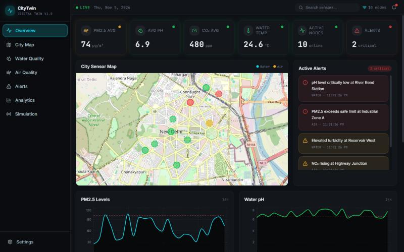

# City Pulse Live

**A live "digital twin" dashboard for city water and air quality, with disaster simulations you can run and watch unfold.**



<!-- TODO before publishing: add the live demo link here once one is deployed. -->

City Pulse Live shows 10 sample sensors on a map of New Delhi and updates their readings every 3 seconds over WebSocket. Trigger a pollution spike, flood or chemical spill, and watch the readings and alerts respond.

> **Note:** readings are simulated by default, so no hardware is needed to try it. The backend also has HTTP and MQTT ingestion paths for connecting real sensors. See [IoT integration](docs/IOT_INTEGRATION.md).

## Features

- **Live updates:** sensor readings are pushed to the browser over WebSocket
- **City map:** water and air sensors on an interactive Leaflet map, colored by status
- **Water quality:** pH, turbidity, TDS and temperature
- **Air quality:** PM2.5, CO₂, NO₂ and humidity
- **Alerts:** a feed of warning and critical sensor conditions
- **Disaster simulation:** pollution spike, flood or water contamination at 1x to 10x speed
- **REST API:** sensors, alerts, analytics and simulation control

## Quick start

You need Node.js 18 or newer and two terminals.

```bash
git clone https://github.com/AlivelliAshwanth/smart_city_pulse.git
cd smart_city_pulse
```

**Terminal 1: backend**

```bash
cd backend
npm install
npm run dev
```

**Terminal 2: frontend**

```bash
npm install
npm run dev
```

Open <http://localhost:8080>, then scroll to **Disaster Simulation** and press **Run Simulation**.

| Service | Address |
|---|---|
| Dashboard | <http://localhost:8080> |
| REST API | <http://localhost:3001> |
| WebSocket | `ws://localhost:3002` |

To change the addresses, create a `.env` file in the project root:

```env
VITE_API_URL=http://localhost:3001
VITE_WS_URL=ws://localhost:3002
```

## How it works

```
Simulated sensors ──┐
HTTP / MQTT input ──┼──> Express backend ──REST + WebSocket──> React dashboard
Disaster scenarios ─┘
```

## Tech stack

- **Frontend:** React, TypeScript, Vite, Tailwind CSS, shadcn/ui, Recharts, Leaflet
- **Backend:** Node.js, Express, TypeScript, `ws`

## API overview

| Method | Endpoint | Purpose |
|---|---|---|
| `GET` | `/health` | Health check |
| `GET` | `/api/sensors/water` | All water sensors |
| `GET` | `/api/sensors/air` | All air sensors |
| `GET` | `/api/sensors/:id` | One sensor |
| `GET` | `/api/alerts` | All alerts |
| `GET` | `/api/analytics/{pm25,ph,co2,turbidity}` | Time series for one metric |
| `POST` | `/api/simulation/start` | Start a scenario: `{ "scenario": "pollution", "speed": 1 }` |
| `POST` | `/api/simulation/stop` | Stop the scenario and reset the sensors |
| `GET` | `/api/simulation/status` | Current simulation state |

The scenario can be `pollution`, `flood` or `contamination`. See the [full API documentation](docs/API_DOCUMENTATION.md).

**WebSocket events:** `initial_data`, `sensor_update`, `alert`, `simulation_start`, `simulation_stop`

## Experimental: anomaly detection and forecasting

The backend has `/api/ml/*` endpoints for anomaly detection and forecasting. They aren't connected to the dashboard yet, and they need a history of sensor readings before they return useful results. See [ML models](docs/ML_MODELS.md).

## Roadmap

<!-- TODO: edit this list to match what you actually plan to do. -->

- [ ] Show anomaly detection in the dashboard
- [ ] Hosted live demo
- [ ] Fix the remaining TypeScript errors in the backend

## License

<!-- TODO: add a LICENSE file, then keep this line in sync with it. -->

ISC
